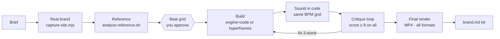
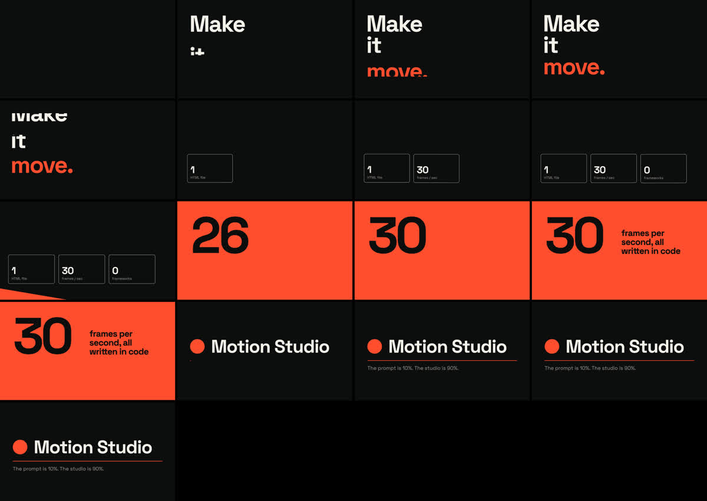

<div align="center">

# Motion Studio

**Motion graphics videos made by Claude Code — from a one-line brief to a finished MP4.**

[](https://code.claude.com/docs/en/plugins)
[](LICENSE)
[](#two-engines-one-studio)
[](#usage)


<sub>Made entirely by this skill — every frame and every sound written in code. <a href="docs/media/motion-studio-code-16x9.mp4">▶ Watch with sound</a></sub>

</div>

---

> **Claude doesn't generate video. It writes a program, and the program becomes video.**
>
> That's why "one prompt, fifteen minutes" posts rarely survive contact with reality: the prompt
> is maybe 10% of the result. The other 90% is the studio around it — the rules, the real
> brand, a reference, a plan locked to the beat, sound, and an honest review loop.
> **Motion Studio is that studio, packaged as a Claude Code skill.**

## Demos

All three clips below are the skill's bundled templates, rendered by the skill itself.
Same concept, two engines, two aspect ratios — the soundtrack is synthesized in code on a
120 BPM grid.

<table>
  <tr>
    <th>Engine <code>code</code> · 16:9</th>
    <th>Engine <code>code</code> · 9:16</th>
    <th>Engine <code>hyperframes</code> · 16:9</th>
  </tr>
  <tr>
    <td align="center" valign="middle"></td>
    <td align="center" valign="middle"></td>
    <td align="center" valign="middle"></td>
  </tr>
  <tr>
    <td align="center"><a href="docs/media/motion-studio-code-16x9.mp4">▶ MP4 with sound</a></td>
    <td align="center"><a href="docs/media/motion-studio-code-9x16.mp4">▶ MP4 with sound</a></td>
    <td align="center"><a href="docs/media/motion-studio-hyperframes-16x9.mp4">▶ MP4 with sound</a></td>
  </tr>
</table>

The vertical cut is not a shrunken landscape video: the same page recomposes its layout for
9:16 — stacked cards, a different type scale, and safe zones for the Reels/TikTok/Shorts UI.

## Features

- 🎬 **A real studio process.** Brief → brand → reference → beat grid → build → sound → critique → render → brand kit.
- 🎛️ **Two engines, one parameter.** `engine=code` writes free-form HTML/JS and renders it frame by frame; `engine=hyperframes` drives [HyperFrames](https://hyperframes.heygen.com) compositions. You choose per video, or set a default.
- 🏷️ **Real brand, not invented.** One command visits the product's site and captures screenshots, logo candidates, fonts, dominant colors and CSS color variables.
- 🎞️ **Learns from references.** Breaks any reference video into contact sheets and scene cuts so Claude can borrow its motion language — never its content.
- 🥁 **Plan on the beat.** Claude shows you a table of every state on the beat grid *before* writing code, and waits for your approval.
- 🔊 **Sound in code.** An original soundtrack and SFX (kick, clap, hats, bass, pads, whoosh, riser, impact, ticks…) synthesized with Web Audio from the same timing constants as the animation — so every hit lands on the frame it should.
- 🧐 **Scored critique loop.** Before you see anything, Claude renders key frames, scores 8 criteria from 1–10, fixes the three worst, and repeats until everything is ≥ 8.
- 📐 **Every format.** 16:9, 9:16, 1:1 and 4:5 from one source, H.264 + AAC, ready for YouTube and social.
- 🧬 **Brand memory.** Once you approve a video, a `brand.md` kit keeps the next one consistent.
- 🚫 **Anti "AI slop" rules.** No centered title on a purple gradient, no fade-everything, no fake screenshots or made-up metrics.

## How it works



## Installation

### As a Claude Code plugin (recommended)

Inside Claude Code:

```text
/plugin marketplace add flaviorg/motion-studio
/plugin install motion-studio@motion-studio
```

Then start a new session (or run `/reload-plugins`).

### Manually, as a skill

```bash
git clone https://github.com/flaviorg/motion-studio.git
cp -R motion-studio/skills/motion-studio ~/.claude/skills/
```

### Requirements

| | Needed for |
|---|---|
| [Claude Code](https://code.claude.com) | everything |
| Node.js 18+ | rendering, brand capture, sound export |
| ffmpeg / ffprobe | encoding, contact sheets, reference analysis |
| HyperFrames skills *(optional)* | `engine=hyperframes` only (`npx hyperframes skills update`) |

On first use the skill runs `scripts/setup.sh`, which installs Playwright and a headless
Chromium **inside the skill folder** — nothing global. On macOS: `brew install node ffmpeg`.

## Usage

Just ask. The skill triggers on any request for an animated or motion video:

```text
Make a 15-second vertical launch video for https://my-product.com — energetic, 124 BPM.
```

```text
/motion-studio engine=hyperframes a 20s YouTube intro for my channel "Build With AI"
```

```text
Turn this reference (ref.mp4) into a 9:16 promo for our app, same motion style, our brand.
```

For anything over ~20 seconds, client work or YouTube, the skill walks you through a
**director brief** (story, emotion, pacing, sound, formats) before planning the beat grid.

### Choosing the engine

| Say… | Engine |
|---|---|
| `engine=code`, "pure code", "without hyperframes" | `code` |
| `engine=hyperframes`, "with hyperframes" | `hyperframes` |
| nothing | your default (continuing projects keep their engine) |

Change your default by telling Claude ("always use hyperframes", "always ask me"). It is stored
in `~/.claude/motion-studio.json` and survives plugin updates:

```json
{ "default_engine": "code" }
```

`default_engine` accepts `code`, `hyperframes` or `ask`.

## Two engines, one studio

| | `code` | `hyperframes` |
|---|---|---|
| How it builds | One hand-written HTML/CSS/JS/SVG/Canvas page | HyperFrames composition: `data-*` clips, GSAP timeline, sub-compositions per scene |
| How it renders | `scripts/render.mjs`: Playwright frame capture → ffmpeg | `npx hyperframes render` |
| Strengths | Total creative freedom; one page → every aspect ratio | Block catalog, Studio timeline editor, captions, footage tools, cloud render |
| Sound | `renderAudio()` in the page, muxed automatically | Same synth, exported to `soundtrack.wav` and placed on the timeline |
| Validation | Critique loop on rendered stills | `hyperframes check` (lint, layout, motion, contrast) + critique loop |
| 8 s 1080p render* | ~6 s | ~6 s |

<sub>* Apple M-series laptop, 240 frames, GPU enabled.</sub>

The process — brief, brand, beat grid, sound on the beat, critique, brand kit — is identical.
Only the build-and-render step changes.

## The critique loop

Claude never shows you its first render. It pulls key frames, scores the video, fixes the
three weakest points and goes again:



```
Round 2 — Brand 9 · Hierarchy 7 · Rhythm 8 · Motion 6 · Composition 8 · Originality 7 · Message 9 · Technical 8
Fix now: (1) Motion: cards enter with a plain fade → mask + spring
(2) Hierarchy: 28 px subtitle in 9x16 → 44 px  (3) Originality: gradient background → real screenshot with push-in
```

| Criterion | What gets checked |
|---|---|
| Brand | Real logo, colors and fonts, applied with intent |
| Hierarchy & legibility | Readable in time; size, contrast, safe zones |
| Rhythm & sync | Cuts and accents on the beat; pacing variation |
| Motion quality | Coherent easing, measured overshoot, no generic fades |
| Composition | Grid, margins, balance — per format |
| Originality | Free of the usual AI-video clichés |
| Message | One clear takeaway and CTA |
| Technical finish | No overflow, missing fonts, flicker, clipping or hard endings |

## The renderer contract (`engine=code`)

Any page that exposes these three things can be rendered — write the rest however you like:

```js
window.MOTION = { width, height, fps: 30, duration: 8, ready: Promise };
window.seek = (t) => { /* draw the exact state at time t (seconds) */ };
window.renderAudio = async (sampleRate) => AudioBuffer; // optional
```

Everything is a pure function of `t`, so frames can be captured in any order, in parallel.
The bundled `kit.js` adds easings, an analytic spring, a beat grid, a seeded RNG, a live
preview with scrubber and audio, and the sound synths.

## Scripts

| Command | What it does |
|---|---|
| `node scripts/render.mjs <project> --format 16x9,9x16 --name launch` | Render MP4s (H.264 + AAC, faststart) |
| `node scripts/render.mjs <project> --every 0.5` | Stills every 0.5 s + `contact.png` |
| `node scripts/render.mjs <project> --stills 1.0,2.5` | Stills at exact times |
| `node scripts/render.mjs <project> --serve` | Live preview in the browser, with sound |
| `node scripts/render.mjs <project> --audio-only --out assets` | Export just the soundtrack WAV |
| `node scripts/capture-site.mjs <url> <out>` | Screenshots, logos, fonts, colors, copy → `brand-capture.json` |
| `bash scripts/analyze-reference.sh <video> <out>` | Scene cuts, timestamped contact sheets, audio |

`render.mjs` also takes `--fps`, `--workers`, `--from/--to` (render a segment), `--crf` and
`--keep-frames`, and reports the audio peak (warning above -1 dBFS).

## Repository layout

```
motion-studio/
├── .claude-plugin/            # plugin + marketplace manifests
├── skills/motion-studio/
│   ├── SKILL.md               # the studio process and engine selection
│   ├── config.json            # default engine (override in ~/.claude/motion-studio.json)
│   ├── references/            # studio rules, director brief, brand & reference, engine guides
│   ├── scripts/               # render.mjs, capture-site.mjs, analyze-reference.sh, setup.sh
│   └── assets/
│       ├── template/              # code-engine starter (the demo above) + kit.js
│       ├── template-hyperframes/  # HyperFrames starter, passes `hyperframes check` clean
│       └── sound/                 # audio-only page for the HyperFrames engine
└── docs/media/                # demo GIFs and MP4s
```

## FAQ

**Does it need an API key or a paid service?** No. Everything renders locally with Playwright
and ffmpeg. HyperFrames' cloud features are optional.

**Can I use my own music or a voiceover?** Yes — the skill loads your file into the same audio
context and ducks the soundtrack under the voice.

**How long can videos be?** Long-form works scene by scene (30–90 s each), rendered and
reviewed separately, then joined. Render time scales roughly linearly with frame count.

**Windows / Linux?** The scripts are plain Node.js, bash and ffmpeg. They were built and tested
on macOS; Linux should work as-is, Windows via WSL or Git Bash.

**The brand capture got blocked.** Some sites block headless browsers. Give Claude the logo,
colors and a few screenshots instead.

## Credits

- The studio method — "the prompt is 10%, the studio is 90%", rules in a project file, real brand
  capture, a reference video, a beat-grid plan, code-made sound and a scored review loop — was
  inspired by Felipe Borges' class
  [*Como Fazer Motion Graphics INSANOS com Opus 5.5*](https://www.youtube.com/watch?v=4wk7nTZler4)
  (Portuguese).
- [HyperFrames](https://hyperframes.heygen.com) by HeyGen powers the `hyperframes` engine.
- [Playwright](https://playwright.dev), [ffmpeg](https://ffmpeg.org) and
  [GSAP](https://gsap.com) do the heavy lifting. Demo typeface:
  [Space Grotesk](https://fonts.google.com/specimen/Space+Grotesk) (SIL Open Font License).

## License

[MIT](LICENSE) © flaviorg
